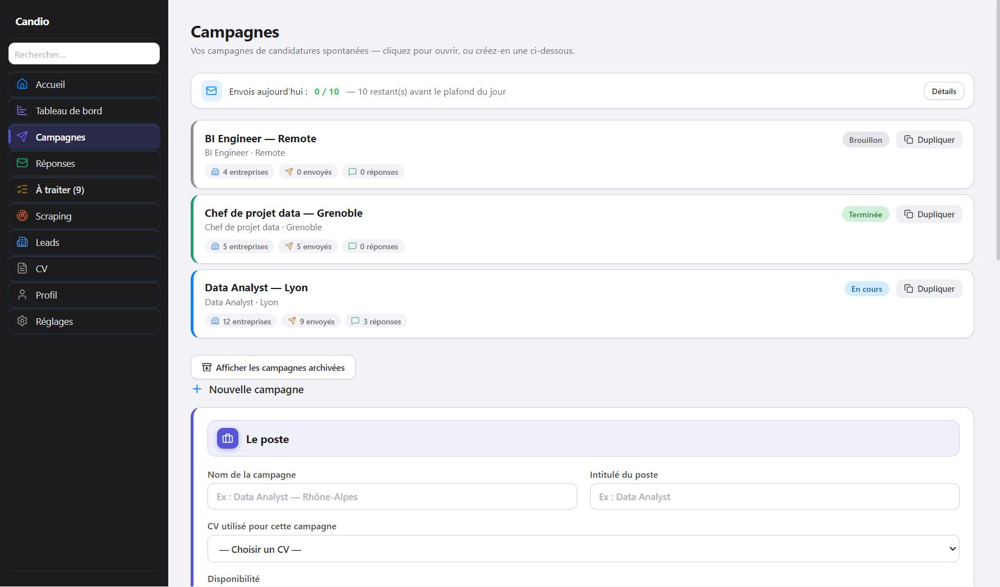
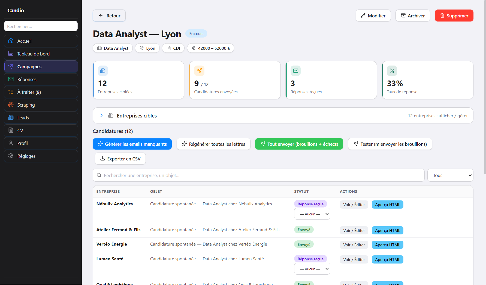
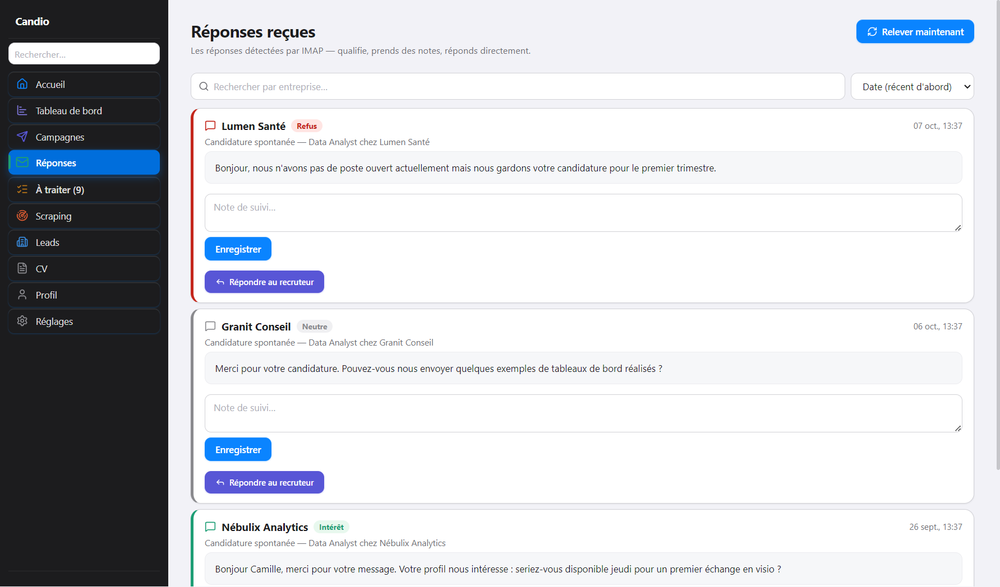
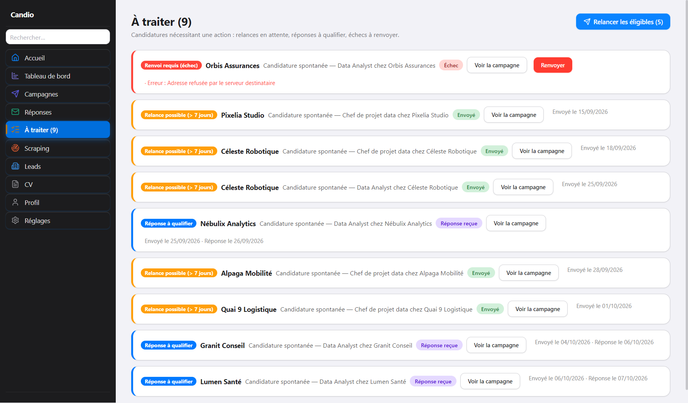
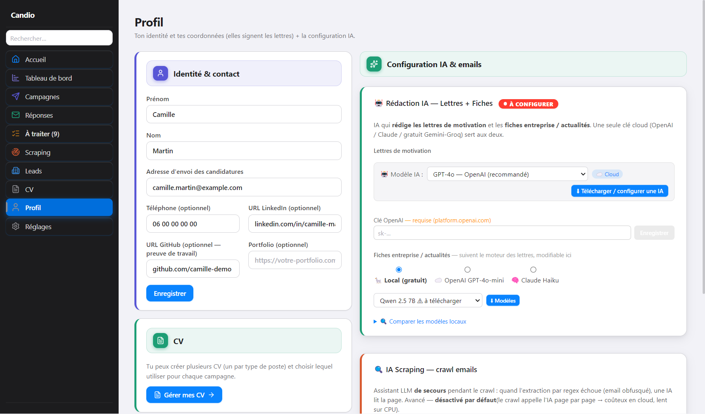
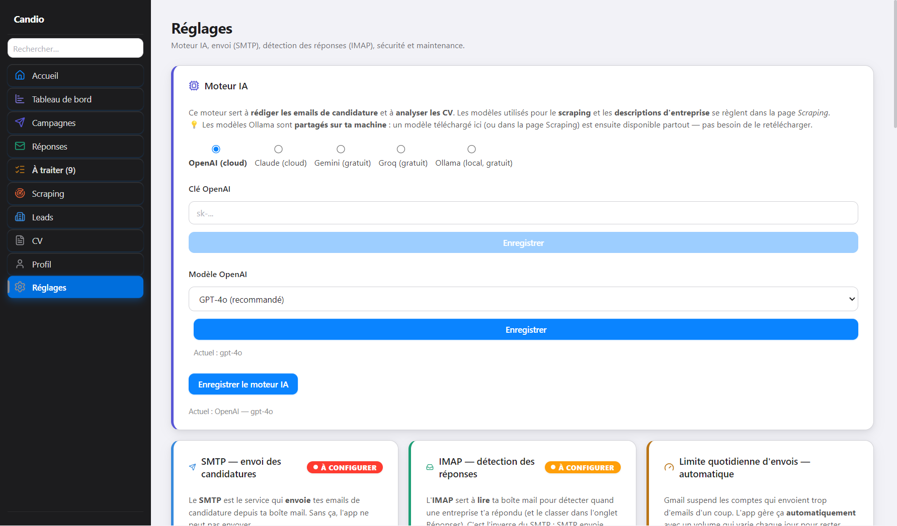

# Candio

Application Windows qui automatise les **candidatures spontanées** de bout en bout :
collecte d'entreprises, rédaction de lettres personnalisées par IA, envoi depuis
votre propre boîte mail, relances, détection des réponses et suivi des résultats.

100 % local : la base SQLite et les secrets (chiffrés via le trousseau Windows)
restent sur votre machine. Aucun compte, aucun serveur.


## Installation

1. Téléchargez `Candio Setup 1.0.0.exe` depuis la page
   [Releases](https://github.com/jordanduplain-svg/Application_dev/releases) du dépôt.
2. Lancez-le. L'installation se fait **pour l'utilisateur courant**, sans droits
   administrateur, et crée un raccourci **Candio** sur le bureau.
3. L'installeur n'est pas signé : si Windows SmartScreen s'affiche, cliquez sur
   **Informations complémentaires → Exécuter quand même**.

Configuration minimale : Windows 10 ou 11, 64 bits.

## Premier lancement

1. **Profil** : identité, adresse d'envoi, liens LinkedIn / GitHub.
2. **CV** : importez un ou plusieurs CV en PDF (un par type de poste).
3. **Réglages** :
   - le moteur IA (OpenAI, Claude, Gemini, Groq, ou Ollama en local et gratuit) ;
   - le **SMTP** pour envoyer (Gmail : un mot de passe d'application) ;
   - l'**IMAP** pour détecter les réponses.
4. **Campagnes** : créez une campagne, ajoutez des entreprises (à la main, par CSV
   ou depuis les leads scrapés), générez les lettres, relisez, envoyez.

## Fonctionnalités

### Campagnes

Une campagne regroupe un poste, une zone, un CV et une liste d'entreprises.
Les lettres sont générées par l'IA à partir du CV et de la fiche de chaque entreprise,
puis restent modifiables une par une avant l'envoi. Un plafond d'envois quotidien
protège la réputation de votre adresse.





### Réponses

Les réponses sont relevées par IMAP et rattachées à la bonne candidature.
Chacune est classée (intérêt, neutre, refus) ; vous pouvez y ajouter une note
et répondre au recruteur directement depuis l'application.



### À traiter

Une seule liste pour tout ce qui attend une action : relances possibles,
réponses à qualifier, envois en échec à renvoyer.



### Profil et réglages





### Et aussi

- Scraping d'entreprises (Python) avec enrichissement par IA et filtres par secteur et région.
- Tableau de bord : entonnoir de conversion, activité, comparaison des campagnes.
- Justificatif France Travail, export CSV, sauvegarde et restauration de la base.
- Verrouillage par code, mise à jour automatique via les GitHub Releases.

> Les captures d'écran montrent des données de démonstration fictives.

## Développement

Prérequis : Node.js 18 ou plus récent, pnpm 8 ou plus récent, Python 3 (scraper).

```powershell
pnpm install
pnpm dev          # lance Electron en mode développement
pnpm build:win    # produit apps/desktop/dist/Candio Setup x.y.z.exe
```

### Stack

- Electron + React + TypeScript + Vite (via electron-vite)
- Prisma + SQLite (un fichier dans le dossier de données utilisateur)
- IPC Electron typé (contrat partagé dans `packages/shared`)
- electron-builder pour l'installeur Windows (NSIS)
- Vitest (unitaires) et Playwright (e2e)

### Arborescence

```
apps/desktop/
├─ electron/           Process principal + preload + handlers IPC
├─ src/                Logique métier (services, tâches de fond, lib)
├─ renderer/           UI React (Vite)
├─ prisma/             Schéma + migrations SQLite
├─ build/              Icône de l'application
└─ electron-builder.yml
packages/shared/       Contrat IPC + schémas Zod (source-only)
scripts/               Scraper Python
docs/screenshots/      Captures du README
```

### Format CSV d'import d'entreprises

Une ligne d'en-têtes obligatoire. Colonnes reconnues (ordre indifférent) :
`name, contactEmail, website, contactName, contactRole`.
Les lignes sans nom ou sans email valide sont ignorées.
